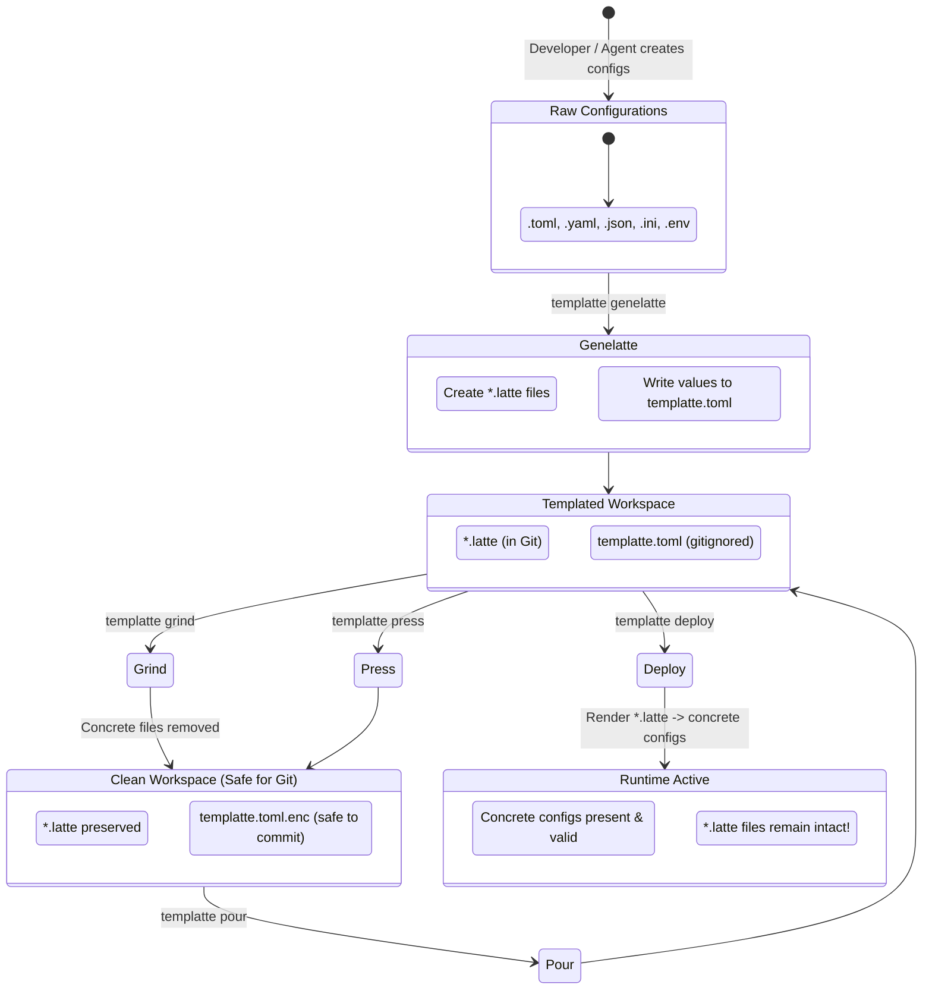

# Templatte 2.0: Master Specification

**Status:** Approved for Implementation  
**Target Version:** `templatte 0.2.0`  
**Paradigm:** Spec-Driven Development (SDD) for AI Agents & Human Developers  
**Author:** Templatte Core Architecture Group  

---

## 1. Vision & Domain Concept

**Templatte** is an automated configuration lifecycle manager and template engine designed around a delightful barista metaphor. It turns scattered, sensitive configuration files (TOML, YAML, JSON, INI, `.env`) into clean, parameter-driven `.latte` templates while centralizing values in a secure, encryptable values registry (`templatte.toml`).

### 1.1 The Problem
In modern software engineering and agentic workflows:
1. Projects require multiple config files across multiple formats (`config.toml`, `settings.yaml`, `.env`, `database.json`).
2. Developers accidentally commit production credentials or local secrets into Git repositories.
3. Managing template files manually (e.g. creating and maintaining `.env.example`, `config.example.toml`) is error-prone and drifts out of sync.
4. AI agents operating in local repositories need a safe, deterministic, non-interactive way to manage environment configurations without leaking credentials.

### 1.2 The Solution
Templatte provides a unified, bidirectional configuration lifecycle:
* **Extract & Abstract:** Automatically discovers configuration files, extracts concrete values into a single structured registry (`templatte.toml`), and writes standardized template files (`.latte`).
* **Secure & Share:** Encrypts sensitive values into a portable, ciphertext envelope (`templatte.toml.enc`) using standard cross-platform cryptography without external dependencies.
* **Deploy & Hydrate:** Injects values back into templates to generate working configuration files on demand—**strictly preserving the template files for future use**.
* **Clean & Protect:** Removes unencrypted concrete files before committing code or switching environments.

---

## 2. The Barista Mental Model

Every command and concept in Templatte maps to the coffee-making process:

| Barista Concept | Templatte Domain Equivalent | Description |
| :--- | :--- | :--- |
| **Coffee Beans / Grounds** | Concrete Configuration Files | The un-abstracted, runnable configuration files in your repository (`config.toml`, `app.yaml`). Contains actual passwords, ports, and hosts. |
| **Latte Art / Steamed Milk** | Template Files (`.latte`) | Clean, parameter-driven template files preserving format and comments, using placeholder tags (e.g., `database.url = "{{ database.url }}"`). |
| **The Blend** | Values Registry (`templatte.toml`) | The centralized registry containing all extracted values organized cleanly by file path and property key. |
| **Roastery (`genelatte`)** | Value Extraction & Templating | Scans the workspace, extracts concrete values to `templatte.toml`, and creates corresponding `.latte` templates. |
| **French Press (`press`)** | Secret Encryption | Encrypts `templatte.toml` using AES-256-GCM authenticated encryption into `templatte.toml.enc`. |
| **Pour-Over (`pour`)** | Secret Decryption | Decrypts `templatte.toml.enc` back into `templatte.toml` using a passphrase or environment key. |
| **Serve / Cup (`deploy`)** | Configuration Hydration | Renders `.latte` templates using values from `templatte.toml` to produce runnable config files. **Templates are never destroyed.** |
| **Coffee Grinder (`grind`)** | Secret Hygiene / Cleanup | Safely deletes concrete configuration files whose templates exist, ensuring zero secret leakage before Git commits. |
| **Roast Check (`check` / `roast`)** | Lint & Drift Detection | Compares deployed files against templates and values, warning of uncommitted secrets or configuration drift. |

---

## 3. Configuration Lifecycle State Machine



---

## 4. Fundamental System Invariants

Any implementation by an AI agent or human must strictly adhere to these invariants:

1. **Non-Destructive Deployment (Invariant 1):**
   `deploy` **MUST NEVER delete or alter `.latte` template files**. Template files are the persistent specification in Git.
2. **Deterministic Workspace-Relative Paths (Invariant 2):**
   All keys and file references in `templatte.toml` must be normalized relative to the workspace root using POSIX forward slashes (e.g. `services/api/config.toml`, never `./services/api/config.toml` or `services\api\config.toml`).
3. **Format & Comment Preservation (Invariant 3):**
   When transforming concrete files into `.latte` files and vice-versa, comments, ordering, indentation, and structure must be preserved where supported by the format parser.
4. **No External System CLI Dependencies (Invariant 4):**
   Templatte must not depend on external binaries (`gpg`, `sops`, `age-cli`). All parsing, templating, and cryptography must run natively within the Python runtime.
5. **Agent & CI/CD First-Class Ergonomics (Invariant 5):**
   Every command must support non-interactive execution (flags or environment variables for passphrases), predictable exit codes, and structured JSON output mode (`--json`).
6. **Reversibility & Idempotency (Invariant 6):**
   Running `genelatte` -> `deploy` must yield identical configuration content to the original files (round-trip idempotency). Running `deploy` multiple times must produce identical results without errors.

---

## 5. Specification of Values Registry (`templatte.toml`)

The values registry `templatte.toml` uses a clean, hierarchical TOML schema organized by relative file paths:

```toml
# templatte.toml - Generated by Templatte 2.0
version = 1
created_at = "2026-09-22T19:00:00Z"
default_profile = "local"

[workspace]
root = "."
ignored_patterns = ["node_modules/**", ".venv/**", "dist/**"]

# Values for tests/example.toml
[files."tests/example.toml"]
format = "toml"

[files."tests/example.toml".values]
title = "TOML Example"
"owner.name" = "Tom Preston-Werner"
"owner.dob" = "1979-05-27T07:32:00-08:00"
"database.enabled" = true
"database.ports" = [8000, 8001, 8002]
"database.data" = [["delta", "phi"], [3.14]]
"database.temp_targets.cpu" = 79.5
"database.temp_targets.case" = 72.0
"servers.alpha.ip" = "10.0.0.1"
"servers.alpha.role" = "frontend"
"servers.beta.ip" = "10.0.0.2"
"servers.beta.role" = "backend"

# Values for config/app.yaml
[files."config/app.yaml"]
format = "yaml"

[files."config/app.yaml".values]
"server.port" = 8080
"server.host" = "0.0.0.0"
"auth.jwt_secret" = "super-secret-key"
```

### Profile Extension (Multi-Environment)
Templatte supports profiles via `templatte.<profile>.toml` (e.g. `templatte.prod.toml`) or inline profile sections:
```toml
[profiles.production."config/app.yaml".values]
"server.host" = "api.production.internal"
"auth.jwt_secret" = "prod-air-gapped-secret"
```

---

## 6. Template File Standard (`*.latte`)

A `.latte` file mirrors the exact path and structure of the original file, appending `.latte` to the filename (e.g. `tests/example.toml.latte`).

### 6.1 Syntax Guidelines
* Delimiters: Jinja2-standard double curly braces `{{ key_path }}` or quoted variants `"{{ key_path }}"` depending on format validity.
* Example for `tests/example.toml.latte`:
```toml
title = "{{ title }}"

[database]
enabled = {{ database.enabled }}
ports = {{ database.ports }}
data = {{ database.data }}

[owner]
name = "{{ owner.name }}"
dob = "{{ owner.dob }}"

[database.temp_targets]
cpu = {{ database.temp_targets.cpu }}
case = {{ database.temp_targets.case }}

[servers.alpha]
ip = "{{ servers.alpha.ip }}"
role = "{{ servers.alpha.role }}"

[servers.beta]
ip = "{{ servers.beta.ip }}"
role = "{{ servers.beta.role }}"
```
* **Format-aware Substitution:** During `deploy`, string placeholders `"{{ key }}"` are parsed and substituted with typed values (booleans, integers, lists) according to the format schema.

---

## 7. Cryptographic Envelope Standard

When encrypted via `templatte press`, the resulting `templatte.toml.enc` file uses a standard, self-describing cryptographic envelope:

```json
{
  "$schema": "https://templatte.dev/schema/v1/encrypted.json",
  "version": 1,
  "algorithm": "AES-256-GCM",
  "kdf": {
    "name": "PBKDF2HMAC",
    "hash": "SHA256",
    "iterations": 600000,
    "salt": "<base64_salt_32_bytes>"
  },
  "iv": "<base64_nonce_12_bytes>",
  "tag": "<base64_auth_tag_16_bytes>",
  "ciphertext": "<base64_ciphertext>"
}
```
* **Security:** Authenticated encryption (AEAD) ensures ciphertext cannot be tampered with or modified undetected.
* **Portability:** Encoded as JSON/Base64, fully inspectable without needing external C libraries or GPG keyrings.
