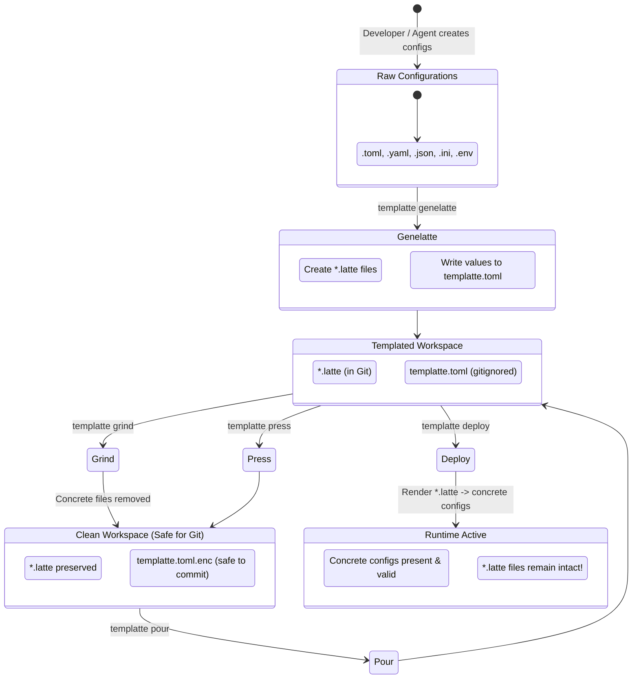

# Templatte 2.0: Master Specification

**Status:** Approved for Implementation  
**Target Version:** `templatte 1.0.0`  
**Paradigm:** Spec-Driven Development (SDD) for AI Agents & Human Developers  
**Author:** Templatte Core Architecture Group  

---

## 1. Vision & Domain Concept

**Templatte** is an automated configuration lifecycle manager and template engine designed around a delightful barista metaphor. It turns scattered, sensitive configuration files (TOML, YAML, JSON, INI, `.env`) into clean, parameter-driven `.latte` templates while centralizing values in a secure, encryptable values registry (`templatte.toml`).

### 1.1 The Problem
In modern software engineering and agentic workflows:
1. Projects require multiple config files across multiple formats (`config.toml`, `settings.yaml`, `.env`, `database.json`).
2. Developers accidentally commit production credentials or local secrets into Git repositories.
3. Managing template files manually (e.g. creating and maintaining `.env.example`, `config.example.toml`) is error-prone and drifts out of sync.
4. AI agents operating in local repositories need a safe, deterministic, non-interactive way to manage environment configurations without leaking credentials.

### 1.2 The Solution
Templatte provides a unified, bidirectional configuration lifecycle:
* **Extract & Abstract:** Automatically discovers configuration files, extracts concrete values into a single structured registry (`templatte.toml`), and writes standardized template files (`.latte`).
* **Secure & Share:** Encrypts sensitive values into a portable, ciphertext envelope (`templatte.toml.enc`) using standard cross-platform cryptography without external dependencies.
* **Deploy & Hydrate:** Injects values back into templates to generate working configuration files on demand—**strictly preserving the template files for future use**.
* **Clean & Protect:** Removes unencrypted concrete files before committing code or switching environments.

---

## 2. The Barista Mental Model

Every command and concept in Templatte maps to the coffee-making process:

| Barista Concept | Templatte Domain Equivalent | Description |
| :--- | :--- | :--- |
| **Coffee Beans / Grounds** | Concrete Configuration Files | The un-abstracted, runnable configuration files in your repository (`config.toml`, `app.yaml`). Contains actual passwords, ports, and hosts. |
| **Latte Art / Steamed Milk** | Template Files (`.latte`) | Clean, parameter-driven template files preserving format and comments, using placeholder tags (e.g., `database.url = "{{ database.url }}"`). |
| **The Blend** | Values Registry (`templatte.toml`) | The centralized registry containing all extracted values organized cleanly by file path and property key. |
| **Roastery (`genelatte`)** | Value Extraction & Templating | Scans the workspace, extracts concrete values to `templatte.toml`, and creates corresponding `.latte` templates. |
| **French Press (`press`)** | Secret Encryption | Encrypts `templatte.toml` using AES-256-GCM authenticated encryption into `templatte.toml.enc`. |
| **Pour-Over (`pour`)** | Secret Decryption | Decrypts `templatte.toml.enc` back into `templatte.toml` using a passphrase or environment key. |
| **Serve / Cup (`deploy`)** | Configuration Hydration | Renders `.latte` templates using values from `templatte.toml` to produce runnable config files. **Templates are never destroyed.** |
| **Coffee Grinder (`grind`)** | Secret Hygiene / Cleanup | Safely deletes concrete configuration files whose templates exist, ensuring zero secret leakage before Git commits. |
| **Roast Check (`check` / `roast`)** | Lint & Drift Detection | Compares deployed files against templates and values, warning of uncommitted secrets or configuration drift. |

---

## 3. Configuration Lifecycle State Machine



---

## 4. Fundamental System Invariants

Any implementation by an AI agent or human must strictly adhere to these invariants:

1. **Non-Destructive Deployment (Invariant 1):**
   `deploy` **MUST NEVER delete or alter `.latte` template files**. Template files are the persistent specification in Git.
2. **Deterministic Workspace-Relative Paths (Invariant 2):**
   All keys and file references in `templatte.toml` must be normalized relative to the workspace root using POSIX forward slashes (e.g. `services/api/config.toml`, never `./services/api/config.toml` or `services\api\config.toml`).
3. **Format & Comment Preservation (Invariant 3):**
   When transforming concrete files into `.latte` files and vice-versa, comments, ordering, indentation, and structure must be preserved where supported by the format parser.
4. **No External System CLI Dependencies (Invariant 4):**
   Templatte must not depend on external binaries (`gpg`, `sops`, `age-cli`). All parsing, templating, and cryptography must run natively within the Python runtime.
5. **Agent & CI/CD First-Class Ergonomics (Invariant 5):**
   Every command must support non-interactive execution (flags or environment variables for passphrases), predictable exit codes, and structured JSON output mode (`--json`).
6. **Reversibility, Fidelity & Idempotency (Invariant 6):**

   The `genelatte` -> `deploy` cycle preserves a configuration file at three
   cumulative levels:

   **6.a — Semantic equivalence (mandatory, all formats).**
   The regenerated file, re-parsed with its format's native parser, must
   produce a data model exactly equal to the original: same keys, same key
   order, same values, same native types. No key may appear, disappear,
   duplicate, or change type.

   **6.b — Readable structure preservation (mandatory wherever the parser
   supports it, per Invariant 3).** Comments (block and inline), section
   order, indentation, and document layout are preserved — a TOML inline
   table remains an inline table, a YAML flow sequence remains in flow
   style, a YAML anchor/merge key remains an anchor and is never expanded,
   a multiline string remains multiline.

   **6.c — Exact fixed point (mandatory, all formats).**
   `genelatte` may normalize a file's lexical formatting exactly once,
   within the bounds of 6.a and 6.b. From the first `deploy` onward, every
   subsequent `genelatte` -> `deploy` cycle is **byte-for-byte identical**:
   the second deploy and every one after it introduce zero differences.
   `deploy` run N times always produces the same byte stream — this is
   what actually protects a user's `git diff` from per-run churn.

   **First-cycle byte-for-byte fidelity** is required only for formats
   whose adapter operates at the line/text level and can guarantee it:

   | Format | First-cycle `genelatte` -> `deploy` guarantee |
   | :--- | :--- |
   | `.env` | **Byte-for-byte**, except the quote style of a value — every value is re-emitted with shell-safe quoting, so it is quoted with `"` when, and only when, it needs to be — and horizontal whitespace before an inline comment. |
   | INI / `.properties` | **Byte-for-byte**, except horizontal whitespace around separators and inline comments. |
   | YAML | 6.a + 6.b + 6.c. Byte-for-byte for the large majority of documents; quote-style and flow-sequence spacing normalization is permitted. |
   | TOML | 6.a + 6.b + 6.c. Scalar lexical representation (radix, thousands separators, exponential notation, quote style — including the choice of multiline delimiter) and internal array spacing normalization is permitted. |
   | JSON | 6.a + 6.b + 6.c. Non-ASCII escaping, numeric notation and separator spacing normalization is permitted; the separator style of a document that mixes styles between object and array level is unified. |

   Every normalization permitted above must be covered by an explicit test
   in the fidelity matrix (`tests/unit/adapters/test_fidelity_matrix.py`)
   documenting the input, the normalized output, and the reason. A
   round-trip difference not present in that matrix is a bug, not a
   normalization.
7. **Git Integration & Secret Hygiene (Invariant 7):**
   Unencrypted `templatte.toml` and concrete runtime configuration files must be automatically tracked in `.gitignore`. Only `*.latte` templates and encrypted envelopes (`templatte.toml.enc`) may be committed to Git. Templatte integrates natively with `git ls-files` to detect and prevent credential leaks.

See [04_GIT_AND_WORKFLOW_SPEC.md](file:///home/elihu/GIT/templatte/docs/spec/04_GIT_AND_WORKFLOW_SPEC.md) for full Git branching, consolidation, and tool-level Git specifications.

---

## 5. Specification of Values Registry (`templatte.toml`)

The values registry `templatte.toml` uses a clean, hierarchical TOML schema organized by relative file paths:

```toml
# templatte.toml - Values Registry
version = 1
default_profile = "default"

[workspace]
ignored_patterns = ["node_modules/**", ".venv/**", "dist/**"]

[template]
open = "{{"
close = "}}"

# Values for tests/example.toml
[files."tests/example.toml"]
format = "toml"

[files."tests/example.toml".values]
title = "TOML Example"
"owner.name" = "Tom Preston-Werner"
"owner.dob" = 1979-05-27T07:32:00-08:00
"database.enabled" = true
"database.ports" = [8000, 8001, 8002]
"database.data" = [["delta", "phi"], [3.14]]
"database.temp_targets.cpu" = 79.5
"database.temp_targets.case" = 72.0
"servers.alpha.ip" = "10.0.0.1"
"servers.alpha.role" = "frontend"
"servers.beta.ip" = "10.0.0.2"
"servers.beta.role" = "backend"

# Values for config/app.yaml
[files."config/app.yaml"]
format = "yaml"

[files."config/app.yaml".values]
"server.port" = 8080
"server.host" = "0.0.0.0"
"auth.jwt_secret" = "super-secret-key"
```

The registry has no timestamp or run-scoped metadata: `version` and `default_profile` are the only top-level scalars, and both are stable across repeated invocations. This is deliberate — two `genelatte` runs over an unchanged workspace must produce byte-identical registry content, which rules out fields like a creation timestamp that would otherwise change on every write for no functional reason.

### Type Representation Across Formats
The registry stores each extracted value using TOML's native type system — the richest of the formats Templatte supports — so that type information is never lost between extraction and deployment. `render()` reconstitutes each type according to the destination format's own conventions:

| Domain Type | Registry (TOML) Representation | TOML Output | YAML Output | JSON Output | INI / `.properties` Output | `.env` Output |
| :--- | :--- | :--- | :--- | :--- | :--- | :--- |
| String | `"value"` | `"value"` | `value` (plain scalar, quoted only if required) | `"value"` | `value` | `value` (quoted if it contains whitespace) |
| Integer | `42` | `42` | `42` | `42` | `42` | `42` |
| Float | `3.14` | `3.14` | `3.14` | `3.14` | `3.14` | `3.14` |
| Boolean | `true` / `false` | `true` | `true` | `true` | `true` / `false` | `true` / `false` |
| Datetime (offset) | native TOML datetime, e.g. `1979-05-27T07:32:00-08:00` | native datetime | ISO-8601 string, e.g. `"1979-05-27T07:32:00-08:00"` | ISO-8601 string | ISO-8601 string | ISO-8601 string |
| Date | native TOML local date, e.g. `1979-05-27` | native date | ISO-8601 date string | ISO-8601 date string | ISO-8601 date string | ISO-8601 date string |
| Time | native TOML local time, e.g. `07:32:00` | native time | ISO-8601 time string | ISO-8601 time string | ISO-8601 time string | ISO-8601 time string |
| Array | native TOML array, e.g. `[8000, 8001, 8002]` | native array | YAML sequence | JSON array | comma-joined string, e.g. `8000,8001,8002` | comma-joined string |
| Array of Tables | indexed dot-path keys, e.g. `servers[0].ip = "10.0.0.1"` (see §6.3) | reconstructed `[[servers]]` blocks | list of mappings | array of objects | flattened indexed keys, e.g. `servers[0].ip=...` | flattened indexed keys |

### Profile Extension (Multi-Environment)
Profiles live inline in the same registry file, as sibling sections under `[profiles.<name>.*]`, rather than in separate per-profile files. This keeps every environment's values inside the single encryption boundary that `press` operates on — encrypting `templatte.toml` protects all profiles at once, and there is never a plaintext `templatte.<profile>.toml` left on disk for a non-default environment:
```toml
[profiles.production."config/app.yaml".values]
"server.host" = "api.production.internal"
"auth.jwt_secret" = "prod-air-gapped-secret"
```

### Secret Marking
Not every extracted value is sensitive — a port number or a feature flag carries no risk if committed in the clear, while a database password does. The registry lets each file declare which of its keys are secrets, under a sibling `secrets` table listing the dot-paths that must be treated as sensitive:
```toml
[files."config/app.yaml".secrets]
"auth.jwt_secret" = true
```
This distinction drives workflow, not storage: `press` still encrypts the whole registry file as a single envelope (there is exactly one encryption boundary, per Invariant 4), but tooling built on top of Templatte — `check`, editor integrations, diff previews — uses the `secrets` table to redact or flag sensitive values in output, and to warn when a value outside this table looks credential-shaped (e.g. a key path containing `password`, `secret`, `token`, or `key`) but isn't marked. A project that has no sensitive values at all can therefore version its plaintext `templatte.toml` directly, reserving `press`/`pour` for the workspaces that do.

---

## 6. Template File Standard (`*.latte`)

A `.latte` file mirrors the exact path and structure of the original file, appending `.latte` to the filename (e.g. `tests/example.toml.latte`).

### 6.1 Syntax Guidelines
* Delimiters: Jinja2-standard double curly braces `{{ key_path }}`.
* **Quoting Rule:** In typed formats (TOML/YAML/JSON), every placeholder is emitted as a quoted string token — `"{{ key_path }}"` — regardless of the destination value's real type (boolean, number, array, table). This is what keeps a `.latte` file a syntactically valid TOML/YAML/JSON document in its own right, parseable by any standard linter, editor, or syntax highlighter without special-casing: a bare `{{ ... }}` token is not valid syntax in any of these formats, but a quoted string is. During `deploy`, the format adapter's `render()` locates the quoted placeholder node and replaces it in place with the real, typed value read from the registry — the surrounding quotes are consumed along with the placeholder, not preserved in the output.
* Example for `tests/example.toml.latte`:
```toml
title = "{{ title }}"

[database]
enabled = "{{ database.enabled }}"
ports = "{{ database.ports }}"
data = "{{ database.data }}"

[owner]
name = "{{ owner.name }}"
dob = "{{ owner.dob }}"

[database.temp_targets]
cpu = "{{ database.temp_targets.cpu }}"
case = "{{ database.temp_targets.case }}"

[servers.alpha]
ip = "{{ servers.alpha.ip }}"
role = "{{ servers.alpha.role }}"

[servers.beta]
ip = "{{ servers.beta.ip }}"
role = "{{ servers.beta.role }}"
```

### 6.2 Delimiters & Compatibility with Other Template Engines
Because `{{ key_path }}` is a common convention shared by Helm, Ansible, GitHub Actions, and Jinja/Nunjucks-based tooling, `genelatte` actively avoids colliding with files that already use it for a different engine:
* During discovery, any candidate file whose content already contains `{{ }}` or `${{ }}` delimiters is excluded from automatic scanning by default and reported as **"requires manual review"** in the command summary, with a non-zero exit code attributed to that specific file — the rest of the scan proceeds normally and is not aborted.
* Delimiters are configurable per workspace via `[template] open = "..."` / `close = "..."` in the values registry (see §5), allowing a project to explicitly opt in to templatizing files that use the default `{{ }}` convention for another engine by choosing a non-colliding pair (e.g. `open = "<%"`, `close = "%>"`).

### 6.3 Arrays-of-Tables Representation
TOML arrays-of-tables (`[[servers]]`) are represented with explicit index notation rather than collapsed into a single opaque placeholder, so that both the `.latte` file and the registry preserve the repeated-table structure element by element.

Given a source file:
```toml
[[servers]]
ip = "10.0.0.1"
role = "frontend"

[[servers]]
ip = "10.0.0.2"
role = "backend"
```

The generated `.latte` preserves each table occurrence:
```toml
[[servers]]
ip = "{{ servers[0].ip }}"
role = "{{ servers[0].role }}"

[[servers]]
ip = "{{ servers[1].ip }}"
role = "{{ servers[1].role }}"
```

And the registry stores each index as its own dot-path key:
```toml
[files."config/app.toml".values]
"servers[0].ip" = "10.0.0.1"
"servers[0].role" = "frontend"
"servers[1].ip" = "10.0.0.2"
"servers[1].role" = "backend"
```

---

## 7. Cryptographic Envelope Standard

When encrypted via `templatte press`, the resulting `templatte.toml.enc` file uses a standard, self-describing cryptographic envelope:

```json
{
  "$schema": "https://templatte.dev/schema/v1/encrypted.json",
  "version": 1,
  "algorithm": "AES-256-GCM",
  "kdf": {
    "name": "PBKDF2HMAC",
    "hash": "SHA256",
    "iterations": 600000,
    "salt": "<base64_salt_32_bytes>"
  },
  "iv": "<base64_nonce_12_bytes>",
  "tag": "<base64_auth_tag_16_bytes>",
  "ciphertext": "<base64_ciphertext>"
}
```
* **Security:** Authenticated encryption (AEAD) ensures ciphertext cannot be tampered with or modified undetected. The canonicalized envelope header (`version`, `algorithm`, and the `kdf` parameters) is itself passed as additional authenticated data (AAD) to the cipher, so the metadata describing how to decrypt the file is authenticated together with the ciphertext — a tampered header fails authentication exactly like tampered ciphertext.
* **Portability:** Encoded as JSON/Base64, fully inspectable without needing external C libraries or GPG keyrings.
