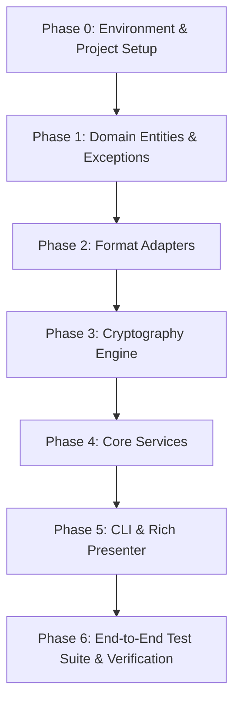

# Templatte 2.0: AI Agent Implementation Harness & Task Roadmap

**Document:** `docs/spec/03_AGENT_HARNESS_AND_TASKS.md`  
**Target:** AI Coding Agents (including lightweight/compact models) & Pair Programmers  
**Design Philosophy:** Spec-Driven Development (SDD) with strict pre/post-conditions, deterministic test verification, and automated guardrails.

---

## 1. Operating Rules for AI Agents

Every AI agent implementing any task in this roadmap **MUST** comply with these non-negotiable rules:

1. **NEVER Delete Templates on Deploy:** `deploy` writes concrete configuration files. It **must never** delete, rename, or truncate `.latte` files.
2. **NEVER Use External CLI Binaries for Cryptography:** Do not call `subprocess.run(["gpg", ...])`. Use the pure-Python `cryptography` library.
3. **Atomic File Operations:** Always write to a temporary file before renaming (`AtomicFileWriter`) to avoid corrupted partial files.
4. **Normalized Workspace Paths:** Always store keys and file references with forward slashes (`/`), stripped of leading `./` or drive letters.
5. **Deterministic Testing:** No task is complete until its corresponding test command passes with zero warnings or errors.

---

## 2. Phased Implementation Roadmap



---

## 3. Detailed Atomic Task Specifications

### Phase 0: Modern Project Setup & Dependencies
#### `TASK-001`: Update `pyproject.toml` and Testing Tools
* **Target File:** `pyproject.toml`
* **Objective:** Modernize dependencies to support Python 3.10+, Typer 0.15+, Cryptography, Rich, and Pytest.
* **Requirements:**
  - Build system: `poetry-core` or standard PEP 621.
  - Dependencies:
    ```toml
    [tool.poetry.dependencies]
    python = ">=3.10,<4.0"
    typer = ">=0.15.0"
    rich = ">=13.7.0"
    cryptography = ">=42.0.0"
    pyyaml = ">=6.0.1"
    tomlkit = ">=0.12.0"
    pydantic = ">=2.6.0"
    
    [tool.poetry.group.dev.dependencies]
    pytest = ">=8.0.0"
    pytest-cov = ">=4.1.0"
    ruff = ">=0.3.0"
    ```
  - Remove `getpass4` completely.
* **Verification Command:** `uv sync || poetry install`

---

### Phase 1: Domain Models & Exceptions
#### `TASK-101`: Domain Exceptions Hierarchy
* **Target File:** `templatte/core/exceptions.py`
* **Objective:** Define explicit, typed exceptions mapped to CLI exit codes.
* **Specification:**
  ```python
  class TemplatteError(Exception):
      """Base exception with exit_code."""
      exit_code: int = 1

  class ValidationError(TemplatteError):
      exit_code: int = 3

  class MissingValuesError(ValidationError):
      def __init__(self, missing_keys: list[str], file_path: str):
          super().__init__(f"Missing values for {file_path}: {missing_keys}")
          self.missing_keys = missing_keys
          self.file_path = file_path

  class CryptoError(TemplatteError):
      exit_code: int = 4

  class InvalidPassphraseError(CryptoError):
      exit_code: int = 4

  class DriftDetectedError(TemplatteError):
      exit_code: int = 5
  ```
* **Verification Command:** `pytest tests/unit/test_exceptions.py`

#### `TASK-102`: Domain Models (`models.py`)
* **Target File:** `templatte/core/models.py`
* **Objective:** Immutable or Pydantic data classes representing workspace entities.
* **Specification:**
  - `ConfigFile`: `path: Path`, `format: str`, `content: str`
  - `TemplateFile`: `path: Path`, `target_config_path: Path`, `placeholders: set[str]`
  - `ValuesRegistry`: `version: int`, `files: dict[str, dict[str, Any]]`
  - `CryptoEnvelope`: `version: int`, `algorithm: str`, `salt: str`, `iv: str`, `tag: str`, `ciphertext: str`
* **Verification Command:** `pytest tests/unit/test_models.py`

---

### Phase 2: Format Adapters (Ports & Adapters)
#### `TASK-201`: Adapter Base Protocol
* **Target File:** `templatte/adapters/base.py`
* **Specification:** As defined in `02_ARCHITECTURE_AND_EXTENSIBILITY.md`.

#### `TASK-202`: TOML Adapter with Comment Preservation
* **Target File:** `templatte/adapters/toml_adapter.py`
* **Objective:** Parse TOML, extract dot-paths, generate valid `.latte` template, and render concrete TOML.
* **Implementation Details:**
  - Use `tomlkit` to preserve comments and table structure.
  - Flatten nested tables using dot notation (`database.ports`).
  - Render: replace placeholder strings `"{{ key }}"` with typed parsed objects.
* **Verification Command:** `pytest tests/unit/adapters/test_toml_adapter.py`

#### `TASK-203`: YAML & JSON Adapters
* **Target Files:** `templatte/adapters/yaml_adapter.py`, `templatte/adapters/json_adapter.py`
* **Objective:** Add YAML (PyYAML/ruamel) and JSON support conforming to `FormatAdapter`.
* **Verification Command:** `pytest tests/unit/adapters/test_yaml_json_adapters.py`

---

### Phase 3: Cryptography Engine
#### `TASK-301`: Pure-Python AES-256-GCM Engine
* **Target File:** `templatte/adapters/crypto/engine.py`
* **Objective:** Implement zero-system-dependency encryption and decryption using PBKDF2-HMAC-SHA256 and AES-256-GCM.
* **Safety Tests:**
  - Round-trip encrypt -> decrypt matches original bytes exactly.
  - Tampering with 1 byte of ciphertext raises `InvalidTag` / `CryptoError`.
  - Supplying the wrong passphrase raises `InvalidPassphraseError`.
* **Verification Command:** `pytest tests/unit/crypto/test_engine.py`

---

### Phase 4: Application Services (Use Cases)
#### `TASK-401`: Generator Service (`genelatte`)
* **Target File:** `templatte/core/services/generator.py`
* **Requirements:**
  - Scans workspace respecting ignore patterns.
  - Generates `.latte` files alongside configs.
  - Merges values into `templatte.toml` without clobbering existing unaffected keys.
* **Verification Command:** `pytest tests/unit/services/test_generator.py`

#### `TASK-402`: Deployer Service (`deploy`)
* **Target File:** `templatte/core/services/deployer.py`
* **STRICT INVARIANT:** Does NOT delete `.latte` files.
* **Requirements:**
  - Validates all keys exist; raises `MissingValuesError` if any placeholder is unbound.
  - Performs atomic file writes using `AtomicFileWriter`.
  - Supports `--dry-run` returning structured action plan.
* **Verification Command:** `pytest tests/unit/services/test_deployer.py`

#### `TASK-403`: Cleaner Service (`grind`)
* **Target File:** `templatte/core/services/cleaner.py`
* **Requirements:**
  - Targets ONLY concrete files that have an active `.latte` counterpart.
  - Never deletes `.latte` files.
  - Supports dry-run and backup archive creation.
* **Verification Command:** `pytest tests/unit/services/test_cleaner.py`

#### `TASK-404`: Checker Service (`check` / `roast`)
* **Target File:** `templatte/core/services/checker.py`
* **Requirements:**
  - Cross-checks placeholders vs values registry.
  - Detects drift between deployed files and template rendering.
* **Verification Command:** `pytest tests/unit/services/test_checker.py`

---

### Phase 5: CLI Presentation Layer
#### `TASK-501`: Typer CLI Commands
* **Target Files:** `templatte/cli/commands/*.py`
* **Requirements:**
  - Wire all services to Typer commands with full options defined in `01_FUNCTIONAL_SPEC.md`.
  - Support `--json` flag printing purely machine-readable JSON to stdout.
  - Map domain exceptions to exact exit codes (0, 1, 2, 3, 4, 5).
  - Rich coffee-themed output for human terminal sessions.
* **Verification Command:** `pytest tests/integration/test_cli.py`

---

## 4. Model Prompt Template for Delegating Tasks

When delegating a task to a compact/lightweight AI agent (e.g. Flash models), use this exact prompt structure:

```markdown
You are an expert Python engineer implementing Templatte 2.0.
Your task is: [INSERT TASK-ID, e.g., TASK-202: TOML Adapter]

Relevant Specifications to Follow:
- Read `docs/spec/00_MASTER_SPEC.md` for domain rules.
- Read `docs/spec/02_ARCHITECTURE_AND_EXTENSIBILITY.md` for interface contracts.

Strict Invariants:
1. NEVER delete or modify *.latte files during deployment.
2. NEVER use external CLI tools (like gpg); use pure Python libraries.
3. Write clean, type-annotated code (Python 3.10+).

Files to create/modify:
- [INSERT TARGET FILE]
- [INSERT TEST FILE]

Verification:
Execute the command: `[INSERT TEST COMMAND]`
Make sure all tests pass before completing your turn.
```

---

## 5. End-to-End Verification Matrix

Before tagging a release or closing modernizations, the agent must run this comprehensive end-to-end scenario:

| Step | Command | Expected Outcome |
| :---: | :--- | :--- |
| 1 | `templatte genelatte --workspace tests/synthetic` | Generates `.latte` files and `templatte.toml`. Exit code `0`. |
| 2 | `templatte grind --workspace tests/synthetic --force` | Deletes concrete configs. `.latte` files remain intact. Exit code `0`. |
| 3 | `templatte deploy --workspace tests/synthetic` | Restores concrete configs. **`.latte` files STILL exist.** Exit code `0`. |
| 4 | `templatte check --workspace tests/synthetic --strict` | Verifies zero drift and complete values coverage. Exit code `0`. |
| 5 | `templatte press --passphrase "Secret123!"` | Creates `templatte.toml.enc` and removes plaintext. Exit code `0`. |
| 6 | `templatte pour --passphrase "Secret123!"` | Restores `templatte.toml`. Exit code `0`. |
