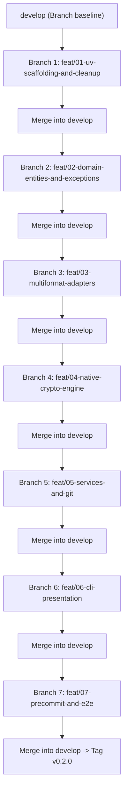

# Templatte 2.0: AI Agent Implementation Harness & Task Roadmap

**Document:** `docs/spec/03_AGENT_HARNESS_AND_TASKS.md`  
**Target:** AI Coding Agents (including lightweight/compact models) & Pair Programmers  
**Design Philosophy:** Spec-Driven Development (SDD) with strict pre/post-conditions, deterministic test verification, and branch-by-branch Git consolidation.

---

## 1. Operating Rules for AI Agents

Every AI agent implementing any task in this roadmap **MUST** strictly comply with these non-negotiable rules:

1. **NEVER Delete Templates on Deploy:** `deploy` writes concrete configuration files. It **must never** delete, rename, or truncate `.latte` files.
2. **NEVER Use External CLI Binaries for Cryptography:** Do not call `subprocess.run(["gpg", ...])`. Use the pure-Python `cryptography` library.
3. **Atomic File Operations:** Always write to a temporary file before renaming (`atomic_write`) to avoid corrupted partial files.
4. **Normalized Workspace Paths:** Always store keys and file references with forward slashes (`/`), stripped of leading `./` or drive letters.
5. **Deterministic Testing:** No task or branch is complete until its corresponding test command passes with zero warnings and zero errors via `uv run pytest`.
6. **Branch-by-Branch Git Isolation:** Every phase/task must be executed in its designated `feat/*` branch created off `develop`, tested, and merged into `develop`. Never commit feature implementations directly to `main` or `develop`.

---

## 2. Phased Branch-by-Branch Roadmap

All feature branches branch from `develop` and merge back into `develop` upon completion:



---

## 3. Detailed Atomic Task Specifications

### Phase 0 / Branch 1: Modern Project Setup with `uv` & Legacy Cleanup
* **Branch Name:** `feat/01-uv-scaffolding-and-cleanup`
* **Base Branch:** `develop`

#### `TASK-001`: Modernize `pyproject.toml` (PEP 621 + Hatchling)
* **Target File:** `pyproject.toml`
* **Objective:** Replace obsolete Poetry configuration with modern PEP 621 standard using `hatchling` backend and `uv` package manager.
* **Specification:**
  ```toml
  [build-system]
  requires = ["hatchling"]
  build-backend = "hatchling.build"

  [project]
  name = "templatte"
  version = "0.2.0"
  description = "Automated configuration lifecycle management and secret encryption with a barista touch"
  readme = "README.md"
  license = { text = "Apache-2.0" }
  authors = [{ name = "elihu" }]
  requires-python = ">=3.10"
  dependencies = [
      "typer>=0.15.1",
      "rich>=13.7.1",
      "cryptography>=42.0.0",
      "tomlkit>=0.13.2",
      "pyyaml>=6.0.2",
      "pydantic>=2.6.0",
  ]

  [project.scripts]
  templatte = "templatte.cli.app:app"

  [dependency-groups]
  dev = [
      "pytest>=8.0.0",
      "pytest-cov>=4.1.0",
      "ruff>=0.3.0",
  ]

  [tool.hatch.build.targets.wheel]
  packages = ["templatte"]

  [tool.ruff]
  line-length = 100
  target-version = "py310"

  [tool.pytest.ini_options]
  testpaths = ["tests"]
  pythonpath = ["."]
  ```

#### `TASK-002`: Purge Legacy Prototype Files
* **Files to Delete:**
  * `poetry.lock` (replaced by `uv.lock`)
  * `templatte.toml` (old test artifact in root)
  * `templatte/restore.py` (obsolete prototype with syntax errors)
  * `templatte/usecase.py`, `templatte/usecase2.py`, `templatte/usecase3.py` (legacy prototypes)
  * `tests2/`, `tests3/` (old unmanaged test folders)
* **Verification Command:** `uv sync && uv run pytest`
* **Merge Gate:** Clean `git status`, successful `uv sync`. Merge into `develop`.

---

### Phase 1 / Branch 2: Domain Entities, Exceptions & Registry
* **Branch Name:** `feat/02-domain-entities-and-exceptions`
* **Base Branch:** `develop`

#### `TASK-101`: Domain Exceptions Hierarchy
* **Target File:** `templatte/core/exceptions.py`
* **Objective:** Define explicit typed exceptions mapped to CLI exit codes (0–5).
* **Verification Command:** `uv run pytest tests/unit/test_exceptions.py`

#### `TASK-102`: Domain Models (`models.py`)
* **Target File:** `templatte/core/models.py`
* **Objective:** Pydantic v2 data models for `ConfigFile`, `TemplateFile`, `ValuesRegistry`, and `CryptoEnvelope`.
* **Verification Command:** `uv run pytest tests/unit/test_models.py`

#### `TASK-103`: Values Registry Persistence (`registry.py`)
* **Target File:** `templatte/core/registry.py`
* **Objective:** Atomically load and save `templatte.toml` using `tomlkit` to preserve comments and table structure.
* **Verification Command:** `uv run pytest tests/unit/test_registry.py`
* **Merge Gate:** 100% tests passing. Merge into `develop`.

---

### Phase 2 / Branch 3: Multiformat Adapters (Ports & Adapters)
* **Branch Name:** `feat/03-multiformat-adapters`
* **Base Branch:** `develop`

#### `TASK-201`: Adapter Base Protocol & Registry
* **Target File:** `templatte/adapters/base.py`, `templatte/adapters/__init__.py`
* **Specification:** As defined in `02_ARCHITECTURE_AND_EXTENSIBILITY.md`.

#### `TASK-202`: TOML Adapter with Comment Preservation
* **Target File:** `templatte/adapters/toml_adapter.py`
* **Objective:** Extract dot-paths and render valid TOML using `tomlkit`. Preserves inline and block comments.

#### `TASK-203`: YAML, JSON, INI, and .env Adapters
* **Target Files:**
  * `templatte/adapters/yaml_adapter.py`
  * `templatte/adapters/json_adapter.py`
  * `templatte/adapters/ini_adapter.py`
  * `templatte/adapters/env_adapter.py`
* **Verification Command:** `uv run pytest tests/unit/adapters/test_adapters.py`
* **Merge Gate:** All adapter roundtrip tests pass. Merge into `develop`.

---

### Phase 3 / Branch 4: Native Cryptography Engine
* **Branch Name:** `feat/04-native-crypto-engine`
* **Base Branch:** `develop`

#### `TASK-301`: Pure-Python AES-256-GCM Engine
* **Target File:** `templatte/adapters/crypto/engine.py`
* **Objective:** Zero-system-dependency authenticated encryption with PBKDF2-HMAC-SHA256 (600,000 iterations).
* **Security & Failure Tests:**
  - Round-trip encrypt -> decrypt matches original bytes exactly.
  - Tampering with 1 byte of ciphertext raises `InvalidPassphraseError`.
  - Wrong passphrase raises `InvalidPassphraseError`.
  - Corrupted JSON envelope raises `CorruptedEnvelopeError`.
* **Verification Command:** `uv run pytest tests/unit/crypto/test_engine.py`
* **Merge Gate:** All crypto tests pass. Merge into `develop`.

---

### Phase 4 / Branch 5: Application Services & Git Integration
* **Branch Name:** `feat/05-services-and-git`
* **Base Branch:** `develop`

#### `TASK-401`: Utilities & Git Helper (`fs.py`, `ignore.py`, `git.py`)
* **Target Files:**
  * `templatte/utils/fs.py` (atomic writes via `tempfile` and `os.replace`)
  * `templatte/utils/ignore.py` (workspace filtering matching `.gitignore`)
  * `templatte/utils/git.py` (git repo detection, tracked file query via `git ls-files`, `.gitignore` updater)

#### `TASK-402`: Scanner & Generator Service (`genelatte`)
* **Target Files:**
  * `templatte/core/services/scanner.py`
  * `templatte/core/services/generator.py`
* **Requirement:** Generates `.latte` templates, writes `templatte.toml`, and appends `templatte.toml` to `.gitignore`.

#### `TASK-403`: Deployer Service (`deploy`)
* **Target File:** `templatte/core/services/deployer.py`
* **STRICT INVARIANT:** Does NOT delete or alter `.latte` files. Renders concrete configs atomically.

#### `TASK-404`: Cleaner (`grind`), Checker (`check`), & Crypto (`press`/`pour`)
* **Target Files:**
  * `templatte/core/services/cleaner.py`
  * `templatte/core/services/checker.py` (detects missing keys, drift, and git leaks)
  * `templatte/core/services/crypto.py`
* **Verification Command:** `uv run pytest tests/unit/services/test_services.py`
* **Merge Gate:** Full service lifecycle tests pass. Merge into `develop`.

---

### Phase 5 / Branch 6: CLI Presentation Layer (Typer & Rich)
* **Branch Name:** `feat/06-cli-presentation`
* **Base Branch:** `develop`

#### `TASK-501`: CLI Framework & Commands
* **Target Files:**
  * `templatte/cli/app.py`
  * `templatte/cli/console.py` (Rich barista theme, banners, tables)
  * `templatte/cli/output.py` (JSON vs Human output formatting)
  * `templatte/cli/commands/*.py` (`genelatte`, `deploy`, `grind`, `press`, `pour`, `check`, `diff`)
  * `templatte/main.py` (entry point exposing `app = templatte.cli.app.app`)
* **Requirements:**
  - Support global `--json` printing purely machine-readable JSON to stdout.
  - Map domain exceptions to exact exit codes (0, 1, 2, 3, 4, 5).
  - Support non-interactive passphrase reading via `--passphrase-env` and `--passphrase`.
* **Verification Command:** `uv run pytest tests/integration/test_cli.py`
* **Merge Gate:** CLI commands and exit codes verified. Merge into `develop`.

---

### Phase 6 / Branch 7: Pre-Commit Hooks & End-to-End Suite
* **Branch Name:** `feat/07-precommit-and-e2e`
* **Base Branch:** `develop`

#### `TASK-601`: Pre-Commit Hooks Definition
* **Target File:** `.pre-commit-hooks.yaml`
* **Objective:** Ship pre-commit hook running `templatte check --strict --check-git`.

#### `TASK-602`: End-to-End Integration Suite
* **Target File:** `tests/e2e/test_full_workflow.py`
* **Verification Command:** `uv run pytest tests/e2e/ && uv run ruff check .`
* **Merge Gate:** Full repository verification. Merge into `develop`.

---

## 4. AI Agent Task Execution Prompt Template

When delegating any task unit to a compact/lightweight model:

```markdown
You are an expert Python engineer working on Templatte 2.0.
Task ID: [TASK_ID, e.g. TASK-202]
Git Working Branch: [BRANCH_NAME, e.g. feat/03-multiformat-adapters]

Specifications to follow:
- Read `docs/spec/00_MASTER_SPEC.md`
- Read `docs/spec/02_ARCHITECTURE_AND_EXTENSIBILITY.md`
- Read `docs/spec/04_GIT_AND_WORKFLOW_SPEC.md`

Non-negotiable Invariants:
1. NEVER delete or alter *.latte files during deploy.
2. NEVER call external system binaries (like gpg); use pure Python cryptography.
3. Use `uv` for running tests: `uv run pytest <test_path>`.

Deliverables:
- Target files to create/modify.
- Unit tests proving correct behavior.
Verification: Execute `[TEST_COMMAND]` and ensure 0 errors and 0 warnings.
```
