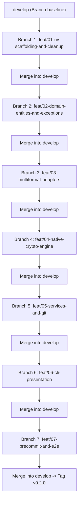

# Templatte 2.0: AI Agent Implementation Harness & Task Roadmap

**Document:** `docs/spec/03_AGENT_HARNESS_AND_TASKS.md`  
**Target:** AI Coding Agents (including lightweight/compact models) & Pair Programmers  
**Design Philosophy:** Spec-Driven Development (SDD) with strict pre/post-conditions, deterministic test verification, and branch-by-branch Git consolidation.

---

## 1. Operating Rules for AI Agents

Every AI agent implementing any task in this roadmap **MUST** strictly comply with these non-negotiable rules:

1. **NEVER Delete Templates on Deploy:** `deploy` writes concrete configuration files. It **must never** delete, rename, or truncate `.latte` files.
2. **NEVER Use External CLI Binaries for Cryptography:** Do not call `subprocess.run(["gpg", ...])`. Use the pure-Python `cryptography` library.
3. **Atomic File Operations:** Always write to a temporary file before renaming (`atomic_write`) to avoid corrupted partial files.
4. **Normalized Workspace Paths:** Always store keys and file references with forward slashes (`/`), stripped of leading `./` or drive letters.
5. **Deterministic Testing:** No task or branch is complete until its corresponding test command passes with zero warnings and zero errors via `uv run pytest`.
6. **Branch-by-Branch Git Isolation:** Every phase/task must be executed in its designated `feat/*` branch created off `develop`, tested, and merged into `develop`. Never commit feature implementations directly to `main` or `develop`.

---

## 2. Phased Branch-by-Branch Roadmap

All feature branches branch from `develop` and merge back into `develop` upon completion:



---

## 3. Detailed Atomic Task Specifications

### Phase 0 / Branch 1: Modern Project Setup with `uv` & Legacy Cleanup
* **Branch Name:** `feat/01-uv-scaffolding-and-cleanup`
* **Base Branch:** `develop`

#### `TASK-001`: Author `pyproject.toml` (PEP 621 + Hatchling)
* **Target File:** `pyproject.toml`
* **Objective:** Define the project entirely in standard PEP 621 form, built with `hatchling`, dependency-locked with `uv.lock`, and managed exclusively through `uv`.
* **Specification:**
  ```toml
  [build-system]
  requires = ["hatchling"]
  build-backend = "hatchling.build"

  [project]
  name = "templatte"
  version = "0.2.0"
  description = "Automated configuration lifecycle management and secret encryption with a barista touch"
  readme = "README.md"
  license = "Apache-2.0"
  license-files = ["LICENSE"]
  authors = [{ name = "elihu" }]
  requires-python = ">=3.10"
  dependencies = [
      "typer>=0.15.1",
      "rich>=13.7.1",
      "cryptography>=42.0.0",
      "tomlkit>=0.13.2",
      "ruamel.yaml>=0.18.6",
      "pathspec>=0.12.1",
      "pydantic>=2.6.0",
  ]

  [project.scripts]
  templatte = "templatte.main:app"

  [dependency-groups]
  dev = [
      "pytest>=8.0.0",
      "pytest-cov>=4.1.0",
      "ruff>=0.3.0",
  ]

  [tool.hatch.build.targets.wheel]
  packages = ["templatte"]

  [tool.ruff]
  line-length = 100
  target-version = "py310"

  [tool.pytest.ini_options]
  testpaths = ["tests"]
  pythonpath = ["."]
  filterwarnings = ["error"]
  ```
  `license-files` uses the PEP 639 form (a list of license file patterns) rather than the legacy `license = { text = "..." }` table, matching current Hatchling metadata conventions. `filterwarnings = ["error"]` is what makes the harness's "zero warnings" rule (§1, rule 5) mechanically enforceable by `uv run pytest` itself, rather than a convention agents must remember to honor unprompted.
* **Verification Command:** `uv sync` — resolves and locks all dependencies into `uv.lock` with no manual intervention. As a CLI application (not a library consumed by other packages), `uv.lock` is committed to the repository so every clone and CI run resolves the exact same dependency graph.

#### `TASK-002`: Purge Legacy Artifacts & Establish the Test Suite Skeleton
* **Files/Directories to Delete:**
  * `poetry.lock` (replaced by `uv.lock`)
  * `dist/` (stale build artifacts from the previous Poetry-based build)
  * `lattes/` (unused empty directory)
  * `templatte/main.py` (the monolithic prototype entry point; rewritten from scratch across `templatte/cli/`, `templatte/core/`, `templatte/adapters/`, and `templatte/utils/` in later branches, then reintroduced in Phase 5 / Branch 6 as the thin entry-point module described in `TASK-502`)
* **Files to Create:**
  * `tests/__init__.py`
  * `tests/test_smoke.py` — a minimal smoke test (e.g. `import templatte`) so that `uv run pytest` has at least one test to collect from the very first branch onward, rather than failing on "no tests collected" before any real test suite exists.
* **Verification Command:** `uv sync && uv run pytest`
* **Merge Gate:** Clean `git status`, successful `uv sync`. Merge into `develop`.

---

### Phase 1 / Branch 2: Foundational Utilities, Domain Entities & Registry
* **Branch Name:** `feat/02-domain-entities-and-exceptions`
* **Base Branch:** `develop`

#### `TASK-100`: Filesystem Safety Utilities (`fs.py`)
* **Target File:** `templatte/utils/fs.py`
* **Objective:** Provide `AtomicFileWriter` — writes to a temporary sibling file, flushes and fsyncs, then swaps it into place via `os.replace` — plus path-sanitization helpers (`is_within_workspace`) used by every subsequent task that writes to disk. This task is intentionally first in the sequence: the registry, every format adapter, and the crypto envelope writer all depend on `AtomicFileWriter` and must not be implemented ahead of it.
* **Verification Command:** `uv run pytest tests/unit/test_fs.py`

#### `TASK-101`: Domain Exceptions Hierarchy
* **Target File:** `templatte/core/exceptions.py`
* **Objective:** Define explicit typed exceptions mapped to CLI exit codes (0–5).
* **Verification Command:** `uv run pytest tests/unit/test_exceptions.py`

#### `TASK-102`: Domain Models (`models.py`)
* **Target File:** `templatte/core/models.py`
* **Objective:** Pydantic v2 data models for `ConfigFile`, `TemplateFile`, `ValuesRegistry`, and `CryptoEnvelope`.
* **Verification Command:** `uv run pytest tests/unit/test_models.py`

#### `TASK-103`: Values Registry Persistence (`registry.py`)
* **Target File:** `templatte/core/registry.py`
* **Objective:** Atomically load and save `templatte.toml` using `tomlkit` to preserve comments and table structure, using `AtomicFileWriter` from `TASK-100`. Parses the registry's `version` field and raises a dedicated `LegacyRegistryError` (exit code `3`, actionable message pointing at `templatte migrate`) when it is absent, rather than surfacing a raw parse error.
* **Verification Command:** `uv run pytest tests/unit/test_registry.py`
* **Merge Gate:** 100% tests passing. Merge into `develop`.

---

### Phase 2 / Branch 3: Multiformat Adapters (Ports & Adapters)
* **Branch Name:** `feat/03-multiformat-adapters`
* **Base Branch:** `develop`

#### `TASK-201`: Adapter Base Protocol & Static Registry
* **Target File:** `templatte/adapters/base.py`, `templatte/adapters/__init__.py`
* **Specification:** As defined in `02_ARCHITECTURE_AND_EXTENSIBILITY.md` §3 — the `FormatAdapter` Protocol plus the static `ADAPTERS: dict[str, type[FormatAdapter]]` mapping and `get_adapter_for_file()` dispatch function.

#### `TASK-202`: TOML Adapter with Comment Preservation
* **Target File:** `templatte/adapters/toml_adapter.py`
* **Objective:** Extract dot-paths and render valid TOML using `tomlkit`. Preserves inline and block comments, native TOML types (datetime, date, time), and reconstructs `[[table]]` arrays-of-tables from indexed registry keys (`servers[0].ip`, `servers[1].ip`, ...) per `00_MASTER_SPEC.md` §6.3.

#### `TASK-203`: YAML and JSON Adapters
* **Target Files:**
  * `templatte/adapters/yaml_adapter.py` (built on `ruamel.yaml` round-trip mode for comment and key-order preservation)
  * `templatte/adapters/json_adapter.py`
* **Verification Command:** `uv run pytest tests/unit/adapters/test_yaml_json_adapters.py`

#### `TASK-204`: INI / `.properties` Adapter
* **Target File:** `templatte/adapters/ini_adapter.py`
* **Objective:** Extract section-qualified dot-paths (`section.key`) from INI and `.properties` files and render typed values back as flattened strings, per the Type Representation table in `00_MASTER_SPEC.md` §5.
* **Verification Command:** `uv run pytest tests/unit/adapters/test_ini_adapter.py`

#### `TASK-205`: `.env` File Adapter
* **Target File:** `templatte/adapters/env_adapter.py`
* **Objective:** Extract flat `KEY=value` pairs (no nesting) from `.env` files, preserving comment lines and blank-line spacing, and render values with shell-safe quoting where needed.
* **Verification Command:** `uv run pytest tests/unit/adapters/test_env_adapter.py`
* **Merge Gate:** All adapter roundtrip tests pass. Merge into `develop`.

---

### Phase 3 / Branch 4: Native Cryptography Engine
* **Branch Name:** `feat/04-native-crypto-engine`
* **Base Branch:** `develop`

#### `TASK-301`: Pure-Python AES-256-GCM Engine
* **Target File:** `templatte/adapters/crypto/engine.py`, `templatte/adapters/crypto/envelope.py`
* **Objective:** Zero-system-dependency authenticated encryption with PBKDF2-HMAC-SHA256 (600,000 iterations). The canonicalized envelope header (`version`, `algorithm`, `kdf` parameters) is passed as AAD to `encrypt`/`decrypt`, per `02_ARCHITECTURE_AND_EXTENSIBILITY.md` §4.1.
* **Security & Failure Tests:**
  - Round-trip encrypt -> decrypt matches original bytes exactly.
  - Tampering with 1 byte of ciphertext raises `InvalidPassphraseError`.
  - Tampering with 1 byte of the AAD-covered header (e.g. the `iterations` field) raises `InvalidPassphraseError`, proving the header is authenticated.
  - Wrong passphrase raises `InvalidPassphraseError`.
  - Corrupted JSON envelope raises `CorruptedEnvelopeError`.
* **Verification Command:** `uv run pytest tests/unit/crypto/test_engine.py`
* **Merge Gate:** All crypto tests pass. Merge into `develop`.

---

### Phase 4 / Branch 5: Application Services & Git Integration
* **Branch Name:** `feat/05-services-and-git`
* **Base Branch:** `develop`

#### `TASK-401`: Git Helper (`git.py`)
* **Target File:** `templatte/utils/git.py`
* **Objective:** `is_git_repo()`, `get_tracked_files()` via `git ls-files`, and `has_uncommitted_changes(path)` (diffing working-tree content against `HEAD`) used by `grind`'s `--force-tracked` guard.

#### `TASK-402`: Scanner & Ignore Evaluation (`scanner.py`, `ignore.py`)
* **Target Files:**
  * `templatte/core/services/scanner.py` (workspace file discovery: applies the default whitelist, `--include`/`--exclude`, the hard denylist, and the `{{ }}`/`${{ }}` foreign-delimiter detection from `00_MASTER_SPEC.md` §6.2)
  * `templatte/utils/ignore.py` (`.gitignore`-compatible pattern evaluation built on `pathspec`, per `02_ARCHITECTURE_AND_EXTENSIBILITY.md` §5)
* **Verification Command:** `uv run pytest tests/unit/test_scanner.py tests/unit/test_ignore.py`

#### `TASK-403`: Generator Service (`genelatte`)
* **Target File:** `templatte/core/services/generator.py`
* **Requirement:** Generates `.latte` templates, writes `templatte.toml`, and idempotently manages the Templatte-owned block in `.gitignore` (marker-delimited, covering `templatte.toml`, `templatte.toml.enc`, and each templatized concrete file).

#### `TASK-404`: Deployer Service (`deploy`)
* **Target File:** `templatte/core/services/deployer.py`
* **STRICT INVARIANT:** Does NOT delete or alter `.latte` files. Renders concrete configs atomically via `AtomicFileWriter`, honoring `--backup`.

#### `TASK-405`: Cleaner (`grind`) & Checker (`check`) Services
* **Target Files:**
  * `templatte/core/services/cleaner.py` (honors `--force-tracked`, using `TASK-401`'s `has_uncommitted_changes`, and `--backup`)
  * `templatte/core/services/checker.py` (detects missing keys, drift — always exit code `5` — and git leaks, elevated to errors only under `--strict`)
* **Verification Command:** `uv run pytest tests/unit/services/test_cleaner.py tests/unit/services/test_checker.py`

#### `TASK-406`: Crypto Orchestration Service (`press` / `pour`)
* **Target File:** `templatte/core/services/crypto.py`
* **Objective:** Orchestrates `press`/`pour` around the `AesGcmCryptoEngine` from `TASK-301`: passphrase acquisition (CLI argument, `--passphrase-file`, environment variable, stdin, interactive prompt, in that priority order), the in-memory decrypt verification step after encryption, and `--backup` handling on overwrite.
* **Verification Command:** `uv run pytest tests/unit/services/test_crypto_service.py`
* **Merge Gate:** Full service lifecycle tests pass. Merge into `develop`.

---

### Phase 5 / Branch 6: CLI Presentation Layer (Typer & Rich)
* **Branch Name:** `feat/06-cli-presentation`
* **Base Branch:** `develop`

#### `TASK-501`: CLI Console & Output Formatting (`console.py`, `output.py`)
* **Target Files:**
  * `templatte/cli/console.py` (Rich barista theme, banners, tables, spinners)
  * `templatte/cli/output.py` (JSON vs. human-readable response handler; when `--json` is set, stdout carries only valid JSON and informational output is redirected to stderr)
* **Verification Command:** `uv run pytest tests/unit/cli/test_output.py`

#### `TASK-502`: CLI Commands & App Wiring
* **Target Files:**
  * `templatte/cli/app.py`
  * `templatte/cli/commands/*.py` (`genelatte`, `deploy`, `grind`, `press`, `pour`, `check`, `migrate`)
  * `templatte/main.py` (thin module exposing `app = templatte.cli.app.app`; this is the single package entry point referenced by `[project.scripts]` in `TASK-001` as `templatte.main:app`)
* **Requirements:**
  - Support global `--json` printing purely machine-readable JSON to stdout.
  - Map domain exceptions to exact exit codes (0, 1, 2, 3, 4, 5).
  - Support non-interactive passphrase reading via `--passphrase`, `--passphrase-file`, `--passphrase-env`, and stdin.
* **Verification Command:** `uv run pytest tests/integration/test_cli.py`
* **Merge Gate:** CLI commands and exit codes verified. Merge into `develop`.

---

### Phase 6 / Branch 7: Pre-Commit Hooks & End-to-End Suite
* **Branch Name:** `feat/07-precommit-and-e2e`
* **Base Branch:** `develop`

#### `TASK-601`: Pre-Commit Hooks Definition
* **Target File:** `.pre-commit-hooks.yaml`
* **Objective:** Ship pre-commit hook running `templatte check --strict --check-git`.

#### `TASK-602`: End-to-End Integration Suite
* **Target File:** `tests/e2e/test_full_workflow.py`
* **Objective:** Exercise the full lifecycle — `genelatte` -> `deploy` -> `grind` -> `press` -> `pour` -> `deploy` -> `check` — against real fixture files per format, per the scenario matrix below.
* **E2E Scenario Matrix:**

  | Step | Command | Assertion |
  | :--- | :--- | :--- |
  | 0 | *(setup)* | Snapshot the byte content of every original fixture file (`tests/fixtures/**`) before any Templatte command runs. |
  | 1 | `templatte genelatte --workspace <ws>` | `.latte` file created for every fixture; `templatte.toml` contains every extracted key; original fixture files are unmodified. |
  | 2 | `templatte deploy --workspace <ws>` | Concrete files regenerated from templates; `.latte` files untouched (Invariant 1). |
  | 3 | `templatte grind --workspace <ws> --force` | Concrete files removed; `.latte` files and `templatte.toml` untouched. |
  | 4 | `templatte press --workspace <ws> --passphrase-file <f>` | `templatte.toml.enc` created; plaintext `templatte.toml` removed; envelope round-trip validated in-process before deletion. |
  | 5 | `templatte pour --workspace <ws> --passphrase-file <f>` | `templatte.toml` restored with byte-identical content to the pre-`press` registry. |
  | 6 | `templatte deploy --workspace <ws>` | Concrete files regenerated again. |
  | 7 | *(verification)* | Byte-for-byte comparison of each regenerated concrete file against its step-0 snapshot — the definitive proof of round-trip fidelity (Invariant 6), beyond structural equality. |
  | 8 | `templatte check --workspace <ws> --strict` | Exit code `0`: no drift, no missing keys, no git leakage. |

  Every step targets the same `--workspace <ws>` fixture directory; `press` and `pour` are not exempt from this — a mismatched workspace between steps is itself a bug the matrix is designed to catch.

* **Verification Command:** `uv run pytest tests/e2e/ && uv run ruff check .`
* **Merge Gate:** Full repository verification. Merge into `develop`.

#### `TASK-603`: Continuous Integration Workflow
* **Target File:** `.github/workflows/ci.yml`
* **Objective:** Run `uv sync`, `uv run ruff check .`, and `uv run pytest` (unit, integration, and e2e suites) on every push and pull request, across a matrix of Linux, macOS, and Windows runners and the supported Python versions (`3.10`, `3.11`, `3.12`, `3.13`).
* **Merge Gate:** All matrix jobs green. Merge into `develop`, then fast-forward `develop` into `main` and tag `v0.2.0`.

---

## 4. AI Agent Task Execution Prompt Template

When delegating any task unit to a compact/lightweight model:

```markdown
You are an expert Python engineer working on Templatte 2.0.
Task ID: [TASK_ID, e.g. TASK-202]
Git Working Branch: [BRANCH_NAME, e.g. feat/03-multiformat-adapters]

Specifications to follow:
- Read `docs/spec/00_MASTER_SPEC.md`
- Read `docs/spec/01_FUNCTIONAL_SPEC.md`
- Read `docs/spec/02_ARCHITECTURE_AND_EXTENSIBILITY.md`
- Read `docs/spec/04_GIT_AND_WORKFLOW_SPEC.md`

Non-negotiable Invariants:
1. NEVER delete or alter *.latte files during deploy.
2. NEVER call external system binaries (like gpg); use pure Python cryptography.
3. Use `uv` for running tests: `uv run pytest <test_path>`.

Deliverables:
- Target files to create/modify.
- Unit tests proving correct behavior.
Verification: Execute `[TEST_COMMAND]` and ensure 0 errors and 0 warnings.
```
