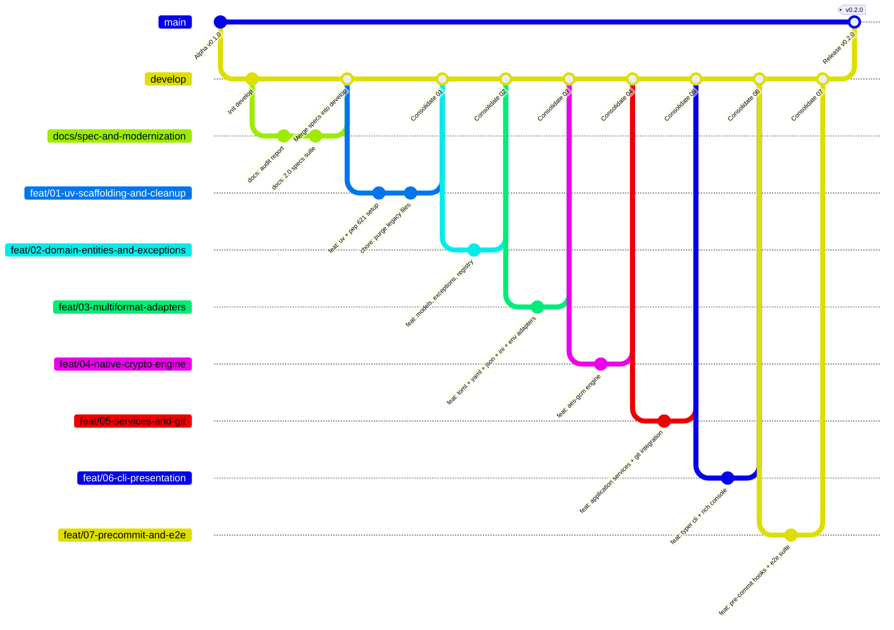

# Templatte 2.0: Git Integration & Branching Workflow Specification

**Document:** `docs/spec/04_GIT_AND_WORKFLOW_SPEC.md`  
**Status:** Approved for Implementation  
**Target:** Development Lifecycle, Git Architecture & Tool-Level Git Integration  

---

## 1. Dual Dimensions of Git in Templatte

Git integration in Templatte exists at two interconnected levels:
1. **Repository & Contribution Workflow (Meta-level):** The Git branching, rework, and consolidation strategy used by developers and AI agents to evolve the Templatte codebase.
2. **Software-Level Git Integration (Tool-level):** How the Templatte CLI itself interacts with Git repositories (automatic `.gitignore` management, pre-commit hooks, tracking verification, and secret leak prevention).

The Templatte repository itself is hosted as a **public** GitHub repository (`github.com/elihu/templatte`), openly licensed under Apache-2.0. Every design decision in this document — branch protection, CI trust boundaries, and the community-facing governance files in §8 — assumes an adversarial, unauthenticated audience: anyone can fork the repository, open a pull request, or read the full commit history, so nothing in the workflow may depend on the repository's contents or history staying private.

---

## 2. Repository Branching & Consolidation Strategy

The repository follows an adapted GitFlow / Trunk-Integration pattern centered on `develop` as the active consolidation branch:



### 2.1 Branch Roles & Policies

| Branch | Protection | Purpose | Merge Policy |
| :--- | :--- | :--- | :--- |
| `main` | **Strictly Protected** | Production releases and published PyPI versions. Never committed to directly. | `develop` is merged into `main` via an explicit **merge commit** upon release — never squashed — so the release history preserves the individual squashed-feature commits that `develop` accumulated. |
| `develop` | **Consolidation Branch** | Central integration branch where all validated features, specs, and reworks converge. | Feature branches merge into `develop` only after passing 100% of tests. |
| `spec/*` or `docs/*` | Working Branch | Dedicated branches for architectural specifications, ADRs, and documentation. | Merged into `develop` via review. |
| `feat/*` | Feature Working Branch | Atomic task/phase implementation branches branched exclusively from `develop`. | Merged into `develop` branch-by-branch after test verification, via **squash merge** — each `feat/*` branch collapses to exactly one commit on `develop`, matching the atomic-task granularity `03_AGENT_HARNESS_AND_TASKS.md` designs its branches around. |
| `fix/*` | Bugfix Branch | Defect repairs branched from `develop`. | Merged back into `develop` via squash merge, same as `feat/*`. |

### 2.2 Branch-by-Branch Implementation Sequence

Every change must be isolated on its own branch branched from `develop` and consolidated into `develop` sequentially:

1. **Branch 0 (Current):** `spec/agent-driven-modernization` (or `docs/spec-and-modernization`)
   * Scope: Audit report, 2.0 specifications suite, updated README.
   * Target: Merged directly into `develop`.
2. **Branch 1:** `feat/01-uv-scaffolding-and-cleanup`
   * Scope: Author `pyproject.toml` in standard PEP 621 form, built with `hatchling` and managed exclusively through `uv`, as specified in `03_AGENT_HARNESS_AND_TASKS.md` TASK-001; configure Ruff and Pytest; and purge repository hygiene artifacts that predate the modularized package: `poetry.lock` (superseded by `uv.lock`), `dist/` (stale build artifacts), `lattes/` (an unused empty directory), and the monolithic `templatte/main.py`, which is rewritten from scratch across the new `templatte/cli/`, `templatte/core/`, `templatte/adapters/`, and `templatte/utils/` modules introduced in Branches 2–6.
3. **Branch 2:** `feat/02-domain-entities-and-exceptions`
   * Scope: Core domain models (`models.py`), typed exceptions (`exceptions.py`), registry manager (`registry.py`).
4. **Branch 3:** `feat/03-multiformat-adapters`
   * Scope: `FormatAdapter` protocol, `TomlAdapter` (with `tomlkit` comment preservation), `YamlAdapter`, `JsonAdapter`, `IniAdapter`, `EnvAdapter`.
5. **Branch 4:** `feat/04-native-crypto-engine`
   * Scope: `AesGcmCryptoEngine` (PBKDF2-HMAC-SHA256 + AES-256-GCM in pure Python), cryptographic envelope format, test suite.
6. **Branch 5:** `feat/05-services-and-git`
   * Scope: `GenelatteService`, `DeployService`, `GrindService`, `CheckService`, `CryptoService`, `GitService`.
7. **Branch 6:** `feat/06-cli-presentation`
   * Scope: Typer CLI layer, Rich barista console formatters, `--json` output handler, exit codes.
8. **Branch 7:** `feat/07-precommit-and-e2e`
   * Scope: Pre-commit hook configuration, end-to-end integration tests, CI workflow, community health and vulnerability-disclosure files (§8), final verification.

---

## 3. Tool-Level Git Integration (Software Features)

Templatte 2.0 is designed to seamlessly integrate with Git to prevent credential leaks and keep repositories clean.

### 3.1 Git Hygiene State Rules

| File Pattern | Git Status | Reason |
| :--- | :--- | :--- |
| `*.latte` | **MUST BE TRACKED** in Git | These are public, sanitized configuration templates containing only placeholders. |
| `templatte.toml` | **MUST BE IGNORED** in `.gitignore` | Contains unencrypted values/secrets for local or active environment. |
| `templatte.toml.enc` | **MAY BE TRACKED** in Git | Authenticated ciphertext envelope (AES-256-GCM); safe for remote repository storage. |
| Concrete config files (`config.toml`, `.env`, etc.) | **MUST BE IGNORED** in `.gitignore` once templated | Contains runtime secrets. Should be cleaned by `templatte grind` before commits. |

---

### 3.2 Automatic `.gitignore` Management
When `templatte genelatte` executes, it inspects the workspace root for `.gitignore` and keeps a dedicated, idempotently-managed block current — covering not only the fixed registry filenames but also, dynamically, the concrete file path of every `.latte` template discovered in the workspace:
1. If `.gitignore` does not exist, Templatte creates it containing only the managed block described below.
2. If `.gitignore` exists but has no managed block, Templatte appends one, delimited by the markers `# >>> templatte managed >>>` and `# <<< templatte managed <<<` (per §2.1's `genelatte` step 7 in `01_FUNCTIONAL_SPEC.md`).
3. On every `genelatte` run, Templatte rewrites the content strictly between those markers — and only that content — to match the current set of discovered templates, leaving the rest of `.gitignore` untouched:
   ```gitignore
   # >>> templatte managed >>>
   # Templatte values & local runtime configurations.
   .env
   .env.*.bak
   config/app.toml
   config/app.toml.*.bak
   templatte.*.toml
   templatte.toml
   templatte.toml.*.bak
   # <<< templatte managed <<<
   ```
   Entries are sorted and de-duplicated. `templatte.toml.enc` and `*.latte` files are intentionally never listed: they are the trackable artifacts of the Templatte lifecycle. Besides the two fixed registry patterns, each entry is either the workspace-relative concrete path derived from one discovered `.latte` file, or the `<path>.*.bak` pattern covering the timestamped backups that `deploy --backup`, `grind --backup`, and `pour --backup` write next to that file or the registry (backups contain plaintext secrets). For example, `config/app.toml.latte` yields `config/app.toml` and `config/app.toml.*.bak`. Entries are added or removed on each run to track the current template set exactly, so a `.latte` file that is later deleted no longer leaves a stale ignore entry behind.
4. Users can disable automatic `.gitignore` updates using `--no-gitignore-update`.

---

### 3.3 Git Leak & Drift Detection (`templatte check --check-git`)
During pre-commit or CI verification, `templatte check --check-git` performs two complementary checks, both built on the Git utilities specified in `02_ARCHITECTURE_AND_EXTENSIBILITY.md` §6.2 — a single `git ls-files` invocation rather than one process spawn per file:
1. **Tracked-file leakage:** Calls `get_tracked_files(workspace)` once to obtain the full set of Git-tracked paths, then compares it in memory against every concrete configuration path derived from a discovered `.latte` file (e.g. `app.toml.latte` -> `app.toml`), and separately against the registry path itself (`templatte.toml`, or the path given via `--config-file`). No per-file `git ls-files --error-unmatch` calls are made.
2. **Untracked-but-uncovered leakage:** Using the same `pathspec`-based matcher that `templatte/utils/ignore.py` uses for workspace discovery, verifies that each concrete configuration path and the registry path are actually matched by a `.gitignore` pattern — catching the case where the file happens not to be tracked yet but nothing would stop `git add .` from picking it up.
3. For any concrete configuration file or registry path that is either tracked by Git or not covered by `.gitignore`:
   - **Warning/Error:** Emits `[red]Git Leak Warning: '<path>' is tracked by Git (or not ignored) but has an active .latte template. Run 'templatte grind' or 'git rm --cached <path>'[/red]`.
   - Exits with code `5` (`ERROR_DRIFT`) regardless of `--strict`, consistent with the exit-code unification in `01_FUNCTIONAL_SPEC.md` §2.6: git leakage is always an actionable defect. Without `--strict`, the same condition is reported as a warning and still returns exit code `5`; `--strict` additionally escalates other non-drift warnings (e.g. unassigned placeholders) into the same error category.

---

### 3.4 Pre-Commit Hook Integration (`.pre-commit-hooks.yaml`)

Templatte provides out-of-the-box support for the Python `pre-commit` framework. `templatte check` operates on the whole workspace rather than on the specific set of staged files pre-commit would otherwise pass as positional arguments, so both the user-facing example and the hook shipped inside the Templatte repository disable filename passing and always run:

```yaml
# In user repositories: .pre-commit-config.yaml
minimum_pre_commit_version: "3.2.0"
repos:
  - repo: https://github.com/elihu/templatte
    rev: v0.2.0
    hooks:
      - id: templatte-check
        name: Templatte Roast & Git Leak Check
        description: Ensures no unencrypted secrets or missing template keys are committed.
        entry: templatte check --strict
        language: python
        pass_filenames: false
        always_run: true
```

`--check-git` defaults to `True` (see `01_FUNCTIONAL_SPEC.md` §2.6), so the canonical hook entry does not need to pass it explicitly; a `--no-check-git` flag exists for the rare case where a user's repository layout makes the Git-tracking check inapplicable and needs to disable it.

Hook definition shipped inside the Templatte repository:
```yaml
# .pre-commit-hooks.yaml
- id: templatte-check
  name: templatte-check
  description: Verifies configuration templates, checks values coverage and blocks git secret leaks.
  entry: templatte check --strict
  language: python
  pass_filenames: false
  always_run: true
  stages: [pre-commit, pre-push]
  minimum_pre_commit_version: "3.2.0"
```

---

## 4. Commit Message Convention

Every commit in the Templatte repository follows [Conventional Commits](https://www.conventionalcommits.org/): `<type>(<scope>): <subject>`.

* **Type:** `feat` (new capability), `fix` (defect repair), `chore` (tooling/housekeeping with no source behavior change), `docs` (documentation-only), `test` (test-only additions or fixes).
* **Scope:** The area touched, matching the module boundaries in `02_ARCHITECTURE_AND_EXTENSIBILITY.md` §2 — e.g. `adapters`, `crypto`, `cli`, `services`, `registry`.
* **Body:** References the corresponding `TASK-ID` from `03_AGENT_HARNESS_AND_TASKS.md` explicitly, so every commit is traceable back to the task it implements:
  ```
  feat(adapters): implement TOML round-trip preservation (TASK-202)

  Extracts dot-paths via tomlkit and renders template content while
  preserving inline/block comments and array-of-tables structure.
  ```

This TASK -> commit traceability is what lets a reviewer (human or agent) reconstruct which commit satisfied which atomic task spec without cross-referencing branch history by hand.

---

## 5. Continuous Integration

`.github/workflows/ci.yml` is the automated status check that makes the `main` branch protection declared in §2.1 actually enforceable — without a required status check configured on the remote repository, branch protection rules have nothing to gate on and are advisory only.

The workflow:
1. Triggers on every push and pull request.
2. Runs a matrix across operating systems (`ubuntu-latest`, `macos-latest`, `windows-latest`) and Python versions (`3.10`, `3.11`, `3.12`, `3.13`), matching the `requires-python` floor and the versions Templatte is tested against.
3. For each matrix cell:
   * `uv sync --frozen` — installs dependencies exactly as pinned in `uv.lock`, failing the job if the lockfile is out of date rather than silently re-resolving.
   * `ruff check .` — static analysis and style enforcement.
   * `uv run pytest` — the full unit, integration, and e2e suite (`03_AGENT_HARNESS_AND_TASKS.md` TASK-603).
4. All matrix jobs are required to pass before a pull request can merge into `develop`, and `develop` before it merges into `main`.

---

## 6. Secret Handling in Git History

Because `templatte.toml.enc` is designed to be committed, every `press` that changes its content leaves an immutable copy of that ciphertext somewhere in Git history, even after later commits supersede it. This has direct operational consequences:

1. **`git rm --cached` does not remove history.** Untracking a file, or even deleting it in a later commit, leaves every prior version — including any commit where a secret was accidentally committed in plaintext (e.g. a `templatte.toml` staged before `grind`/`press` ran) — fully recoverable from the repository's object database.
2. **The only real remedy for a historical leak is history rewriting**, via `git filter-repo` (preferred) or the BFG Repo-Cleaner, followed by a coordinated force-push and every collaborator re-cloning or hard-resetting their local copy.
3. **Rewriting history is necessary but not sufficient.** Any clone, fork, or CI cache made before the rewrite retains the original blob. The credential or passphrase that was exposed must always be rotated, regardless of how thoroughly the history is cleaned — rewriting removes the leak from the canonical repository, it does not un-expose whatever was already read from it.
4. **Passphrase compromise and the encrypted envelope.** Because every historical commit of `templatte.toml.enc` remains decryptable with whatever passphrase encrypted it, a single passphrase compromise makes every past version of the registry readable, not just the current one. This is why `press` enforces the 14-character minimum from `01_FUNCTIONAL_SPEC.md` §2.4, and why a project should maintain a periodic passphrase rotation habit: decrypt the current registry with the old passphrase, re-encrypt it with a new one, and commit the resulting `templatte.toml.enc`. Rotation protects values going forward; it is not retroactive remediation — every version committed before the rotation stays decryptable with the old passphrase if that old passphrase is ever exposed, so rotation is a hygiene practice, not a substitute for treating any exposed passphrase as permanently compromised.

---

## 7. Release Process

1. **Version bump:** `pyproject.toml`'s `[project].version` is the single source of truth for the package version; it is never duplicated into another file that could drift out of sync.
2. **Tagging:** After `develop` is merged into `main` (§2.1), an annotated tag `vX.Y.Z` is created on the resulting `main` commit.
3. **Downstream consumption:** That tag is the `rev:` value third-party repositories pin in their own `.pre-commit-config.yaml` (§3.4) when adopting the Templatte pre-commit hook — an annotated tag on `main` gives downstream consumers a stable, signed-off reference point rather than a moving branch.

---

## 8. Public Repository Governance & Security Posture

Because the repository is public, the workflow around it must assume every pull request, issue, and Actions run may originate from an untrusted third party, not just from the maintainer or a delegated agent.

### 8.1 Community Health Files

A public open-source repository is expected to ship a standard set of governance files at its root, all authored in Branch 7 alongside the CI workflow (`03_AGENT_HARNESS_AND_TASKS.md` TASK-604):

* **`CONTRIBUTING.md`** — documents the branch-by-branch workflow (§2), the Conventional Commits + `TASK-ID` convention (§4), and how an external contributor proposes a change outside the agent-driven roadmap (fork, `fix/*` branch, PR against `develop`).
* **`CODE_OF_CONDUCT.md`** — the Contributor Covenant, so participation expectations are explicit before the project accepts outside contributions.
* **`.github/ISSUE_TEMPLATE/`** — separate templates for bug reports and feature requests; the bug template explicitly instructs reporters not to paste secrets, encrypted registries, or workspace paths that could reveal sensitive project structure.
* **`.github/PULL_REQUEST_TEMPLATE.md`** — prompts the author for the `TASK-ID` (if any), the verification command output, and a checklist confirming no `templatte.toml`, `.env`, or other concrete configuration file was accidentally staged.

### 8.2 Vulnerability Disclosure (`SECURITY.md`)

Templatte's core value proposition is a cryptographic engine (`02_ARCHITECTURE_AND_EXTENSIBILITY.md` §4.1) protecting values that are, by design, committed to a public repository. A flaw in that engine is not an ordinary bug: filing it as a public GitHub issue would disclose the exploit to every fork and clone simultaneously, including any that hold real encrypted registries. `SECURITY.md` therefore specifies:

1. **Private reporting channel:** GitHub's private vulnerability reporting (Security Advisories), not the public issue tracker, is the only channel for anything affecting `AesGcmCryptoEngine`, the envelope format, or passphrase handling.
2. **Scope:** what counts as a security issue (envelope forgery, passphrase brute-force feasibility below the documented KDF cost, plaintext leakage through `grind`/`press`/`pour`, `.gitignore` management failing to cover a templatized file) versus an ordinary bug report.
3. **Response commitment:** an explicit acknowledgment window and a policy of coordinated disclosure — a fix is released and tagged before the advisory is made public, giving downstream users a chance to upgrade first.

### 8.3 GitHub Actions Trust Boundary

The CI workflow (§5) runs on every pull request, including ones opened from forks by contributors with no write access to the repository. `.github/workflows/ci.yml` (`03_AGENT_HARNESS_AND_TASKS.md` TASK-603) is specified with this boundary in mind:

1. **Trigger:** `pull_request`, never `pull_request_target` — the former runs against the PR's own code with a read-only, repository-scoped token and no access to repository secrets; the latter runs with the base repository's permissions and secrets against untrusted PR code, which is the standard vector for a fork to exfiltrate secrets or push malicious changes through CI. Templatte's CI needs no secrets at all (it only runs `uv sync`, `ruff check`, and `pytest` against public dependencies), which removes the incentive to ever reach for `pull_request_target`.
2. **Least-privilege token:** the workflow declares `permissions: contents: read` at the top level (overriding the org/repo default, which may be broader), since the workflow never needs to write to the repository, open PRs, or manage releases itself.
3. **Pinned third-party actions:** every non-`actions/*` step (e.g. `astral-sh/setup-uv`) is pinned to a full commit SHA rather than a floating tag (`@v3`) or branch, closing the supply-chain risk of an upstream action being retagged to point at malicious code after Templatte's workflow already trusts it.
4. **Dependency and Actions hygiene:** `.github/dependabot.yml` is configured for both the `pip`/`uv` ecosystem (keeping `uv.lock` current) and the `github-actions` ecosystem (keeping pinned SHAs current against known-good releases) — a public repository is a standing target, so stale dependencies and stale Actions pins are treated as a continuous risk, not a one-time setup step.

### 8.4 Branch Protection Rules

Concretely, on top of the roles already defined in §2.1, both `main` and `develop` are configured on GitHub with:

1. Require a pull request before merging — direct pushes are rejected even for repository administrators.
2. Require the CI workflow (§5) to pass and the branch to be up to date with its base before merging.
3. Require at least one approving review before a pull request from an external contributor (i.e. not the maintainer or a delegated agent acting on the maintainer's branch) can merge.
4. Disallow force-pushes and branch deletion on `main` and `develop`.

These rules are what make "Strictly Protected" in §2.1's table an enforced GitHub setting rather than a documentation-only convention.
