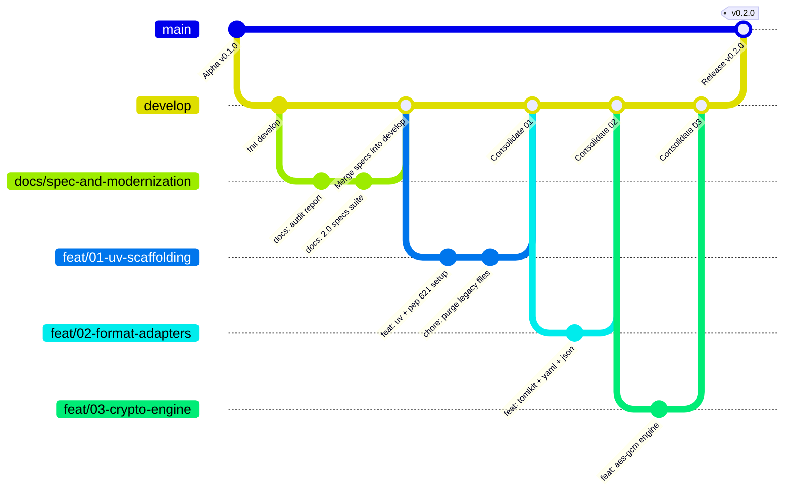

# Templatte 2.0: Git Integration & Branching Workflow Specification

**Document:** `docs/spec/04_GIT_AND_WORKFLOW_SPEC.md`  
**Status:** Approved for Implementation  
**Target:** Development Lifecycle, Git Architecture & Tool-Level Git Integration  

---

## 1. Dual Dimensions of Git in Templatte

Git integration in Templatte exists at two interconnected levels:
1. **Repository & Contribution Workflow (Meta-level):** The Git branching, rework, and consolidation strategy used by developers and AI agents to evolve the Templatte codebase.
2. **Software-Level Git Integration (Tool-level):** How the Templatte CLI itself interacts with Git repositories (automatic `.gitignore` management, pre-commit hooks, tracking verification, and secret leak prevention).

---

## 2. Repository Branching & Consolidation Strategy

The repository follows an adapted GitFlow / Trunk-Integration pattern centered on `develop` as the active consolidation branch:



### 2.1 Branch Roles & Policies

| Branch | Protection | Purpose | Merge Policy |
| :--- | :--- | :--- | :--- |
| `main` | **Strictly Protected** | Production releases and published PyPI versions. Never committed to directly. | Only fast-forward or merge commits from `develop` upon release. |
| `develop` | **Consolidation Branch** | Central integration branch where all validated features, specs, and reworks converge. | Feature branches merge into `develop` only after passing 100% of tests. |
| `spec/*` or `docs/*` | Working Branch | Dedicated branches for architectural specifications, ADRs, and documentation. | Merged into `develop` via review. |
| `feat/*` | Feature Working Branch | Atomic task/phase implementation branches branched exclusively from `develop`. | Merged into `develop` branch-by-branch after test verification. |
| `fix/*` | Bugfix Branch | Defect repairs branched from `develop`. | Merged back into `develop`. |

### 2.2 Branch-by-Branch Implementation Sequence

Every change must be isolated on its own branch branched from `develop` and consolidated into `develop` sequentially:

1. **Branch 0 (Current):** `spec/agent-driven-modernization` (or `docs/spec-and-modernization`)
   * Scope: Audit report, 2.0 specifications suite, updated README.
   * Target: Merged directly into `develop`.
2. **Branch 1:** `feat/01-uv-scaffolding-and-cleanup`
   * Scope: Migrate to `uv` + PEP 621 `pyproject.toml` (Hatchling), configure Ruff and Pytest, clean up legacy prototype files (`templatte/restore.py`, `usecase*.py`, `templatte.toml`, `tests2`, `tests3`, `poetry.lock`).
3. **Branch 2:** `feat/02-domain-entities-and-exceptions`
   * Scope: Core domain models (`models.py`), typed exceptions (`exceptions.py`), registry manager (`registry.py`).
4. **Branch 3:** `feat/03-multiformat-adapters`
   * Scope: `FormatAdapter` protocol, `TomlAdapter` (with `tomlkit` comment preservation), `YamlAdapter`, `JsonAdapter`, `IniAdapter`, `EnvAdapter`.
5. **Branch 4:** `feat/04-native-crypto-engine`
   * Scope: `AesGcmCryptoEngine` (PBKDF2-HMAC-SHA256 + AES-256-GCM in pure Python), cryptographic envelope format, test suite.
6. **Branch 5:** `feat/05-application-services-and-git`
   * Scope: `GenelatteService`, `DeployService`, `GrindService`, `CheckService`, `CryptoService`, `GitService`.
7. **Branch 6:** `feat/06-cli-typer-and-rich`
   * Scope: Typer CLI layer, Rich barista console formatters, `--json` output handler, exit codes.
8. **Branch 7:** `feat/07-precommit-and-e2e-suite`
   * Scope: Pre-commit hook configuration, end-to-end integration tests, final verification.

---

## 3. Tool-Level Git Integration (Software Features)

Templatte 2.0 is designed to seamlessly integrate with Git to prevent credential leaks and keep repositories clean.

### 3.1 Git Hygiene State Rules

| File Pattern | Git Status | Reason |
| :--- | :--- | :--- |
| `*.latte` | **MUST BE TRACKED** in Git | These are public, sanitized configuration templates containing only placeholders. |
| `templatte.toml` | **MUST BE IGNORED** in `.gitignore` | Contains unencrypted values/secrets for local or active environment. |
| `templatte.toml.enc` | **MAY BE TRACKED** in Git | Authenticated ciphertext envelope (AES-256-GCM); safe for remote repository storage. |
| Concrete config files (`config.toml`, `.env`, etc.) | **MUST BE IGNORED** in `.gitignore` once templated | Contains runtime secrets. Should be cleaned by `templatte grind` before commits. |

---

### 3.2 Automatic `.gitignore` Management
When `templatte genelatte` executes, it inspects the workspace root for `.gitignore`:
1. If `.gitignore` does not exist, Templatte creates it with standard configuration ignores.
2. If `.gitignore` exists, Templatte verifies whether `templatte.toml` is listed:
   - If missing, it appends a dedicated Templatte section:
     ```gitignore
     # Templatte values & local runtime configurations
     templatte.toml
     templatte.*.toml
     !templatte.toml.enc
     !*.latte
     ```
3. Users can disable automatic `.gitignore` updates using `--no-gitignore-update`.

---

### 3.3 Git Leak & Drift Detection (`templatte check --check-git`)
During pre-commit or CI verification, `templatte check` interrogates Git via `git ls-files`:
1. Scans all discovered `*.latte` files in the workspace.
2. Computes the corresponding concrete configuration path (e.g. `app.toml.latte` -> `app.toml`).
3. Executes `git ls-files --error-unmatch <concrete_path>`.
4. If a concrete configuration file is tracked by Git:
   - **Warning/Error:** Emits `[red]Git Leak Warning: '<concrete_path>' is tracked by Git but has an active .latte template. Run 'templatte grind' or 'git rm --cached <concrete_path>'[/red]`.
   - In `--strict` mode: exits with code `5` (`ERROR_DRIFT`).

---

### 3.4 Pre-Commit Hook Integration (`.pre-commit-hooks.yaml`)

Templatte provides out-of-the-box support for the Python `pre-commit` framework:

```yaml
# In user repositories: .pre-commit-config.yaml
repos:
  - repo: https://github.com/elihu/templatte
    rev: v0.2.0
    hooks:
      - id: templatte-check
        name: Templatte Roast & Git Leak Check
        description: Ensures no unencrypted secrets or missing template keys are committed.
        entry: templatte check --strict --check-git
        language: python
        pass_filenames: false
```

Hook definition shipped inside the Templatte repository:
```yaml
# .pre-commit-hooks.yaml
- id: templatte-check
  name: templatte-check
  description: Verifies configuration templates, checks values coverage and blocks git secret leaks.
  entry: templatte check
  language: python
  types: [text]
  stages: [pre-commit, pre-push]
```
